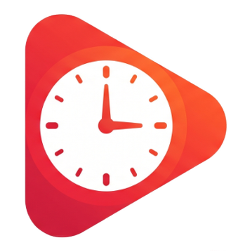

# TimeTube AI — Ad-Free YouTube Player, Background Music & 4K Video Downloader for Android

**Watch YouTube without ads, play music with the screen off, download 4K videos and M4A audio to your Gallery, and travel back in time to discover videos from 2005–2026. Free APK, no login, 100% private.**

**[🌐 Website](https://timetubeai.site)** • **[⬇️ Download APK](https://timetubeai.site/download)** • **[📖 User Guide](https://timetubeai.site/guide)** • **[📝 Blog](https://timetubeai.site/blog)** • **[❓ FAQ](https://timetubeai.site/faq)**

⭐ **If TimeTube AI helps you, please star this repo. It helps more people find it.** ⭐

---

## 📑 Table of Contents

- [What is TimeTube AI?](#-what-is-timetube-ai)
- [Key Features](#-key-features)
- [Download & Install (APK)](#️-download--install-apk)
- [How to Use](#-how-to-use)
- [TimeTube AI vs Other Apps](#-timetube-ai-vs-other-apps)
- [Privacy First](#-privacy-first)
- [System Requirements](#-system-requirements)
- [What's New](#-whats-new)
- [Frequently Asked Questions](#-frequently-asked-questions)
- [Support & Community](#-support--community)
- [Disclaimer](#️-disclaimer)

---

## 🎬 What is TimeTube AI?

**TimeTube AI** is a free Android app for watching and downloading YouTube videos. It gives you an **ad-free video player**, **background play with the screen off**, a **Spotify-style music mode**, **4K / 1080p video downloads** and **M4A audio downloads** saved straight to your phone Gallery.

It also has **AI Time-Travel Search**: pick any year from **2005 to 2026** to find old uploads, early camcorder clips, forgotten music videos and Time Capsules.

You don't need a Google account, a paid subscription or a login. Your watch history, playlists and downloads stay **on your device**.

> **In short:** ad-free YouTube, background music, Picture-in-Picture and a 4K downloader in one free APK.

---

## ✨ Key Features

### 🚫 Ad-Free Streaming + SponsorBlock
- No pre-roll, mid-roll or banner ads
- Built-in **SponsorBlock** skips sponsor segments, intros, outros and "like & subscribe" reminders automatically
- Smooth HD, Full HD and **4K (2160p)** playback

### 🎵 Spotify-Style Background Music
- Keep listening with the **screen off** or while using other apps
- Lock-screen and notification **media controls with artwork**
- Dedicated **Music Home** and **Music Player** screens for songs, naats and podcasts
- **Smart Autoplay**: the next track matches what you're playing (song → song, naat → naat, short stays short, long talks stay long) and never loops back to something already played
- **Sleep timer**, so music stops on its own

### ⬇️ 4K Video & M4A Audio Downloader
- Download **MP4** in **4K, 1440p, 1080p, 720p, 480p, 360p**
- Download **M4A audio only** for music and podcasts
- Files save straight to **`Downloads/TimeTube AI`** and show up in your **Gallery** and music player
- **Download queue**, **pause & resume**, **3 automatic retries** on network errors
- **Wi-Fi only** download option to save mobile data
- **Download a whole playlist** with one tap
- Downloads are kept across app updates and restarts

### 🪟 Dual Picture-in-Picture (PiP)
- **In-app floating mini-player** while you browse feeds and search
- **Android system PiP** when you swipe to the home screen

### 🕰️ AI Time-Travel Search (2005–2026)
- Search YouTube **by year** or a **custom date range**
- Find **old viral videos**, early vlogs, raw camcorder footage and classic music videos
- Curated **Time Capsules** for each era

### 🌍 Country Feeds, Categories & Live
- Trending feeds by **country** and **category**
- **Personalized home feed** based on your interests and stored on-device only
- Watch **Live HLS streams**

### 👆 Pro Player Gestures
- **Double-tap** to seek 10 seconds forward or back
- **Swipe** for brightness and volume
- **Pinch to zoom** to fill the screen
- Choose **quality** and **playback speed**

### 📚 Library
- **Watch history**, **bookmarks** and custom **playlists**
- Browse **channels** and their uploads
- **Downloaded badge** shows which videos you already saved

### 🔄 In-App Updates
- New versions download **inside the app** with a progress bar, then open the Android installer. You don't have to look for the APK again.

---

## ⬇️ Download & Install (APK)

| Version | Size | Link |
|---|---|---|
| **v1.7.0 (Latest)** | APK | **[⬇️ Download from GitHub](https://github.com/CodewithAsif396/timetube-ai/releases/download/v1.7.0/TimeTube-AI-v1.7.0.apk)** |
| Mirror | APK | **[⬇️ Download from timetubeai.site](https://timetubeai.site/download)** |
| Older versions | — | [All releases](https://github.com/CodewithAsif396/timetube-ai/releases) |

### How to install on Android

1. **Download** the APK from one of the links above.
2. **Open** the downloaded file from your notifications or the *Files / Downloads* app.
3. If Android asks, allow **"Install unknown apps"** for your browser or file manager.
4. Tap **Install**, then **Open**.
5. If **Google Play Protect** shows a warning, tap **More details → Install anyway**. This warning appears for any app that isn't installed from the Play Store.

📖 Step-by-step guide with screenshots: **[timetubeai.site/guide](https://timetubeai.site/guide)**

---

## 📱 How to Use

| I want to… | Do this |
|---|---|
| Watch without ads | Search or open any video. Ads are skipped automatically |
| Play music with the screen off | Open a video → tap **Audio** → lock your phone |
| Download a video in 4K | Open a video → tap **Download** → choose **2160p** |
| Download MP3 / M4A music | Open a video → tap **Download** → choose **Audio (M4A)** |
| Download a full playlist | Open the playlist → tap **Download all** |
| Find old videos from 2010 | Open **Time-Travel Search** → choose the year **2010** |
| Watch while using other apps | Press the home button while a video is playing to enter **PiP** |
| Stop music after 30 minutes | Tap **Sleep** → choose **30 min** |

---

## 🆚 TimeTube AI vs Other Apps

| Feature | **TimeTube AI** | Official YouTube app (free) | Typical downloader apps |
|---|:---:|:---:|:---:|
| No ads | ✅ | ❌ | ⚠️ Often full of ads |
| Background play (screen off) | ✅ | ❌ (Premium only) | ⚠️ Sometimes |
| 4K video download to Gallery | ✅ | ❌ | ⚠️ Often limited |
| M4A audio download | ✅ | ❌ | ⚠️ Sometimes |
| SponsorBlock | ✅ | ❌ | ❌ |
| Picture-in-Picture | ✅ In-app + system | ⚠️ Limited | ⚠️ Sometimes |
| Search by year (2005–2026) | ✅ | ❌ | ❌ |
| Playlist download | ✅ | ❌ | ⚠️ Rare |
| No login required | ✅ | ⚠️ Needed for most features | ✅ |
| Price | **Free** | Free / Premium is paid | Free with ads |

---

## 🔒 Privacy First

- **No account, no login, no sign-up**
- **No personal data stored on our servers**
- Watch history, bookmarks, playlists, interests and downloads stay **100% on your device**
- Only anonymous error reports (no personal info) are used to fix playback and download bugs

Read the full policy: **[timetubeai.site/privacy](https://timetubeai.site/privacy)**

---

## 📋 System Requirements

- **Android 7.0 (Nougat) or newer**
- About **100 MB** of free space, plus space for your downloads
- Internet connection (Wi-Fi or mobile data)
- Works on phones and tablets from Samsung, Xiaomi / Redmi / POCO, Oppo, Vivo, Realme, Infinix, Tecno, OnePlus, Motorola, Google Pixel and others

---

## 🆕 What's New

**v1.7.0**
- New **Music Home** and **Music Player** with song rows
- New **Playlist screen** and **Downloaded** badges
- HD playback improvements and a smarter **personalized feed**

**v1.6.x**
- **In-app updates**: the APK downloads inside the app with progress
- Faster and more reliable startup

**v1.5.0**
- **Smart Autoplay** that keeps playing similar content in the background
- **Download queue**, **Wi-Fi only** mode, **auto-retry** and **playlist download**

Full changelog: **[Releases](https://github.com/CodewithAsif396/timetube-ai/releases)**

---

## ❓ Frequently Asked Questions

<b>Is TimeTube AI free?</b>

Yes. TimeTube AI is completely free. There are no subscriptions, in-app purchases or ads.

<b>How do I watch YouTube without ads on Android?</b>

Install the TimeTube AI APK and play any video. Ads are skipped automatically, and SponsorBlock removes sponsor segments inside videos too.

<b>Can I play YouTube in the background with the screen off?</b>

Yes. Tap **Audio** on any video and lock your phone. Playback continues, and lock-screen controls work like Spotify.

<b>How do I download YouTube videos in 4K to my Gallery?</b>

Open a video, tap **Download** and choose **2160p (4K)**. The file is saved to `Downloads/TimeTube AI` and shows up in your Gallery.

<b>Can I download YouTube music as audio (MP3/M4A)?</b>

Yes. Choose **Audio (M4A)** in the download menu. M4A is high-quality audio that plays in every Android music player.

<b>Is TimeTube AI safe?</b>

Download it only from this GitHub repo or **[timetubeai.site](https://timetubeai.site)**. The app doesn't ask for a login and doesn't upload your personal data. The Play Protect warning appears because the app is installed outside the Play Store.

<b>Why isn't TimeTube AI on the Google Play Store?</b>

Google doesn't allow apps with ad-free playback, background play or video downloads on the Play Store. That's why TimeTube AI is distributed as an APK.

<b>Do I need a Google account?</b>

No. TimeTube AI works without any login.

<b>How do I update the app?</b>

TimeTube AI tells you when a new version is out and downloads it inside the app. You can also download the latest APK from [Releases](https://github.com/CodewithAsif396/timetube-ai/releases/latest).

<b>Does it work on iPhone / iOS?</b>

Not at the moment. TimeTube AI is available for Android only.

---

## 💬 Support & Community

- 🌐 Website: **[timetubeai.site](https://timetubeai.site)**
- 📝 Guides & comparisons: **[timetubeai.site/blog](https://timetubeai.site/blog)**
- 🐞 Found a bug or have a feature idea? **[Open an issue](https://github.com/CodewithAsif396/timetube-ai/issues)**
- ⭐ **Star this repo** and share it with friends to help TimeTube AI grow

---

## 🏷️ Keywords

`ad-free youtube` · `youtube without ads android` · `youtube background play` · `youtube video downloader apk` · `4k video downloader android` · `youtube to m4a` · `youtube music downloader` · `screen off youtube` · `picture in picture youtube` · `sponsorblock android` · `youtube playlist downloader` · `old youtube videos search` · `youtube vanced alternative` · `free youtube premium alternative` · `timetube` · `timetube ai apk`

---

## ⚠️ Disclaimer

TimeTube AI is developed by **[Mubarah Solutions](https://timetubeai.site)** and is an independent, third-party media client. It is **not affiliated with, endorsed by, or sponsored by YouTube or Google LLC**. "YouTube" is a trademark of Google LLC. Please download only content you have the right to download, and respect creators and copyright laws in your country.

Full disclaimer: **[timetubeai.site/disclaimer](https://timetubeai.site/disclaimer)**

**Made with ❤️ by Mubarah Solutions** • **[timetubeai.site](https://timetubeai.site)**

